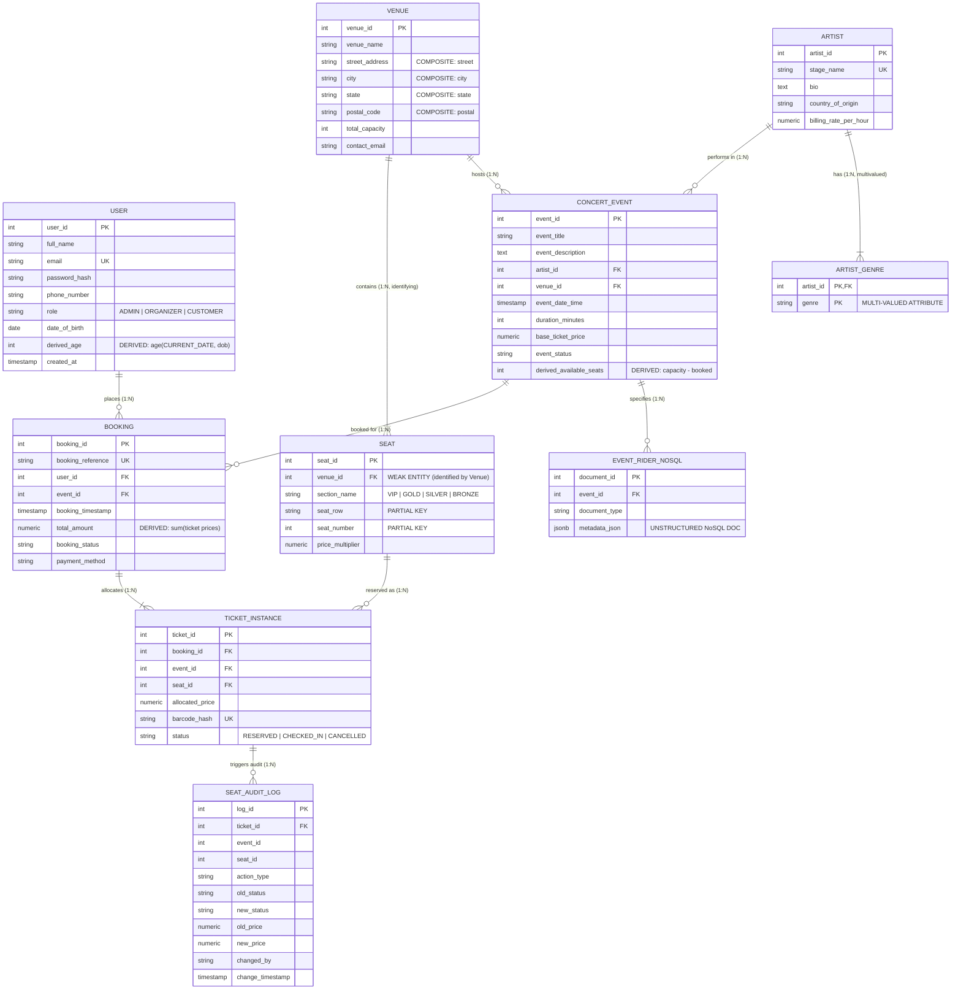

# PES University - Department of Computer Science & Engineering
## Experiential Learning Level 3 - DBMS Mini-Project
### Project Title: Concert and Live Event Management & Intelligent Seat Reservation System

---

## 1. Executive Summary & Architecture Overview
The **Concert and Live Event Management & Intelligent Seat Reservation System** models a high-throughput, mission-critical event management ecosystem. It supports multiple live concert venues, multi-genre performers, multi-tier seating topologies, dynamic surge pricing, atomic seat reservations to eliminate concurrency conflicts, and an intelligent recommendation engine.

---

## 2. ER Diagram Specification & Entity Classification

---

## 3. Explicit Classification of Attributes & Entities (For Viva Evaluation)

### A. Entity Types
1. **Strong Entities**:
   - `USER_PROFILES`: Exists independently; possesses independent primary key `user_id`.
   - `VENUES`: Independent physical arena; primary key `venue_id`.
   - `ARTISTS`: Independent performer entity; primary key `artist_id`.
   - `CONCERT_EVENTS`: Scheduled live show; primary key `event_id`.
   - `BOOKINGS`: Commercial transaction header; primary key `booking_id`.

2. **Weak Entities**:
   - `SEATS`: Cannot exist in isolation without a parent `VENUE`. Its existence depends on the identifying relationship with `VENUE`. Partial discriminator: `(section_name, seat_row, seat_number)` scoped within `venue_id`.
   - `TICKET_INSTANCES`: Weak/associative entity dependent on `BOOKINGS` and `CONCERT_EVENTS`. Represents the tangible seat ticket allocated for a particular event.

---

### B. Attribute Types
1. **Key Attributes**:
   - Primary Keys: `user_id`, `venue_id`, `artist_id`, `event_id`, `seat_id`, `booking_id`, `ticket_id`.
   - Candidate / Alternate Unique Keys: `email` (User), `stage_name` (Artist), `booking_reference` (Booking), `barcode_hash` (Ticket Instance).

2. **Composite Attributes**:
   - `Venue_Address`: Decomposed into four atomic attributes:
     - `street_address`
     - `city`
     - `state`
     - `postal_code`

3. **Multi-Valued Attributes**:
   - `Artist_Genres`: An artist often belongs to multiple musical genres (e.g., A.R. Rahman $\rightarrow$ Sufi, World Fusion, Soundtrack). Normalized into the dependent relation `ARTIST_GENRES(artist_id, genre)`.

4. **Derived Attributes**:
   - `User Age`: Derived dynamically from `date_of_birth` as:
     $$\text{Age} = \text{EXTRACT(YEAR FROM age(CURRENT\_DATE, date\_of\_birth))}$$
   - `Available Seats Count`: Derived dynamically for any event as:
     $$\text{Available Seats} = \text{Venue Total Capacity} - \text{COUNT(Active Ticket Instances)}$$
   - `Booking Total Amount`: Derived dynamically as:
     $$\text{Total Amount} = \sum \text{Allocated Ticket Price}$$

---

## 4. Relationship Types & Cardinality Ratios

| Relationship | Participating Entities | Cardinality | Participation | Description |
|---|---|:---:|:---:|---|
| **Hosts** | `VENUES` $\rightarrow$ `CONCERT_EVENTS` | **1 : N** | Venue (Partial), Event (Total) | One venue can host multiple concerts; each concert must be held at exactly one venue. |
| **Performs** | `ARTISTS` $\rightarrow$ `CONCERT_EVENTS` | **1 : N** | Artist (Partial), Event (Total) | One artist performs in multiple concerts; each concert has a headliner artist. |
| **Contains** | `VENUES` $\rightarrow$ `SEATS` | **1 : N** | Venue (Total), Seat (Total) | Identifying relationship; a venue contains physical seat rows and sections. |
| **Places** | `USERS` $\rightarrow$ `BOOKINGS` | **1 : N** | User (Partial), Booking (Total) | A customer can make multiple bookings; each booking belongs to one user. |
| **Pertains To** | `CONCERT_EVENTS` $\rightarrow$ `BOOKINGS` | **1 : N** | Event (Partial), Booking (Total) | A concert receives many bookings. |
| **Allocates** | `BOOKINGS` $\rightarrow$ `TICKET_INSTANCES` | **1 : N** | Booking (Total), Ticket (Total) | A booking contains one or more allocated seat tickets. |
| **Occupies** | `SEATS` $\rightarrow$ `TICKET_INSTANCES` | **1 : N** | Seat (Partial), Ticket (Total) | A seat is reserved across different concert events over time. |
